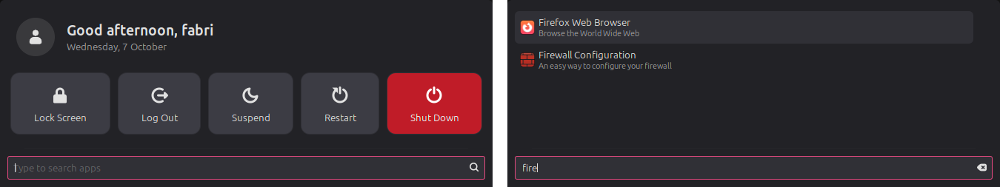

# search-menu

All I ever used the Cinnamon menu for was search and the power buttons, so I made a menu
that's just that.



It opens to a greeting, big Lock / Log Out / Suspend / Restart / Shut Down tiles and the
search bar. Start typing and the apps show up in the same space, so the menu never
changes size. No categories, no app list you have to scroll through.

## Install

```
curl -fsSL https://raw.githubusercontent.com/nagasab221/search-menu/main/install.sh | bash
```

No sudo needed. It takes the normal menu's spot on the panel and keeps its settings
(Super key, icon and so on). Run the same command again to update.

Works over SSH too, as long as you're logged into Cinnamon on that machine. If nobody's
logged in, it still installs and the menu shows up at the next login.

You can also clone the repo and run `./install.sh` yourself.

## Uninstall

```
curl -fsSL https://raw.githubusercontent.com/nagasab221/search-menu/main/install.sh | bash -s -- --remove
```

or `./install.sh --remove`. The normal menu comes back in the same spot with your settings.

## Using it

- Type to search, Enter opens the first result.
- With nothing typed, Tab or the arrow keys move between the tiles and Enter picks one.
  Enter on an empty search does nothing, so you can't lock or shut down by accident.
- Restart, Shut Down and Log Out ask before doing anything. Suspend doesn't.
- The avatar is your account picture (System Settings → Account details).

## Settings

Right-click the menu and hit Configure. It has all the normal menu settings, plus
**Compact menu** on the Content page. Turn that off and you get the regular Cinnamon menu
back, categories and all.

## How it works

It's Cinnamon's own menu (`menu@cinnamon.org`) with a few changes on top. The installer
doesn't ship a copy of that menu: it takes the one from the Cinnamon on your machine and
applies the changes in `build.py`, so it always matches your Cinnamon version. If a future
Cinnamon changes the menu in a way `build.py` doesn't expect, the installer stops and
leaves your menu alone.

Tile shapes and spacing are in `files/stylesheet.css`. The colors come from your theme.

Tested on Linux Mint 22.3 with Cinnamon 6.6.

Licensed under the GPL v2, like the Cinnamon menu it's based on.
